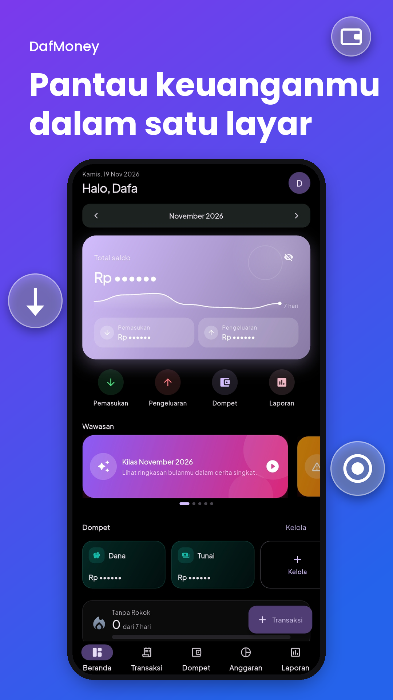
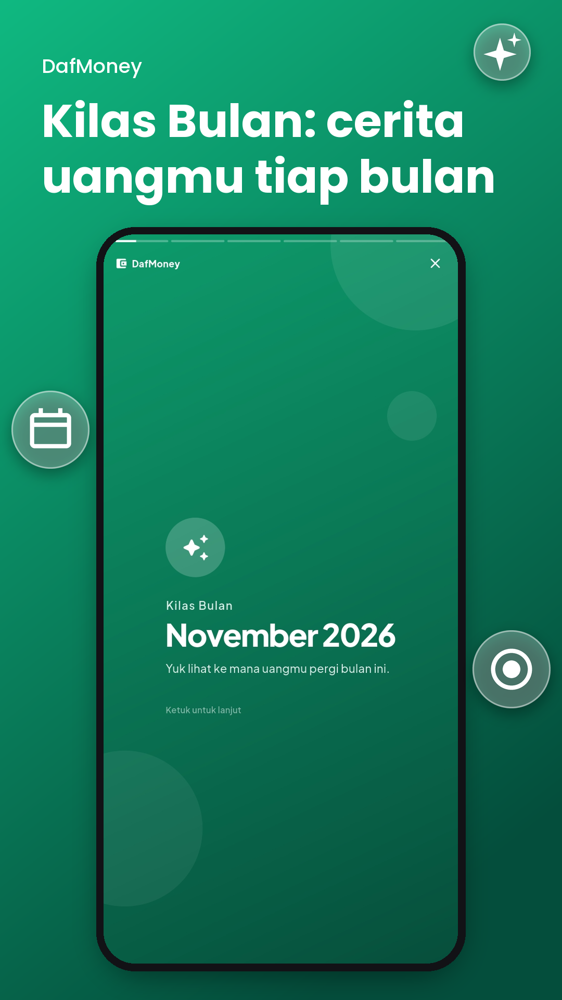
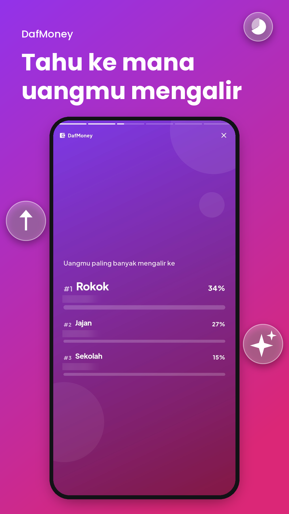
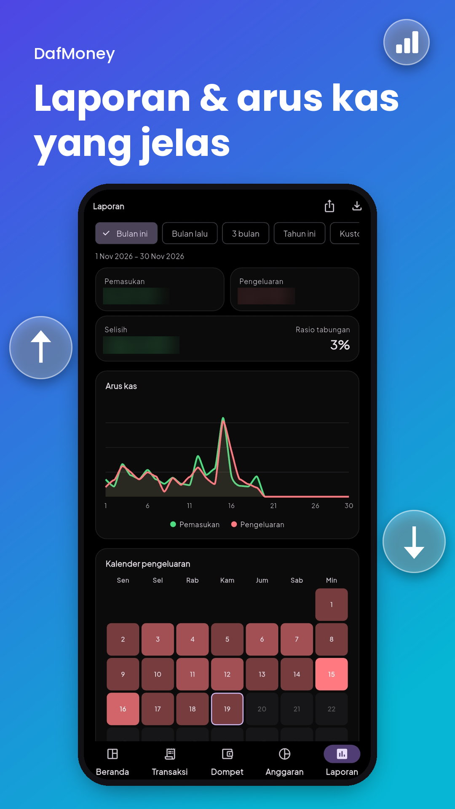
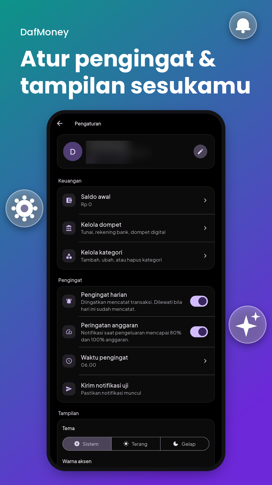

<div align="center">

# 💰 DafMoney

**Aplikasi catatan keuangan pribadi yang modern, cepat, dan enak dipakai.**

Catat pemasukan & pengeluaran dalam hitungan detik, pantau anggaran, dan pahami ke mana uangmu mengalir.


</div>

---

## 📸 Tampilan Aplikasi

<table>
  <tr>
    <td align="center"><br/><b>Beranda</b><br/>Saldo, dompet, wawasan</td>
    <td align="center"><br/><b>Kilas Bulan</b><br/>Cerita keuangan bulanan</td>
    <td align="center"><br/><b>Kategori Teratas</b><br/>Ke mana uangmu mengalir</td>
    <td align="center"><br/><b>Laporan</b><br/>Arus kas & kalender pengeluaran</td>
    <td align="center"><br/><b>Pengaturan</b><br/>Pengingat & tampilan</td>
  </tr>
</table>

---

## 📖 Daftar Isi

- [Fitur Utama](#-fitur-utama)
- [Catat Cepat (Android)](#-catat-cepat-android)
- [Teknologi](#️-teknologi--library)
- [Arsitektur & Struktur Proyek](#-arsitektur--struktur-proyek)
- [Model Data Firestore](#-model-data-firestore)
- [Panduan Setup](#-panduan-setup--instalasi)
- [Keamanan](#-keamanan)
- [CI/CD](#-cicd)
- [Pengujian](#-pengujian)
- [Troubleshooting](#-troubleshooting--faq)
- [Lisensi](#-lisensi)

---

## 🌟 Fitur Utama

### 🔐 Akun & Keamanan
- **Daftar & masuk** dengan Email dan Kata Sandi (Firebase Authentication).
- **Verifikasi email** wajib sebelum data bisa diakses, ditegakkan juga di sisi server lewat Firestore Rules.
- **Lupa kata sandi** dengan tautan reset lewat email.
- **Manajemen profil:** ubah nama, ganti kata sandi, dan hapus akun beserta seluruh datanya.
- **Onboarding** singkat untuk pengguna baru dan **splash screen** animatif.

### 🏠 Beranda (Dashboard)
- **Kartu saldo** dengan grafik mini 7 hari, total pemasukan, dan total pengeluaran bulan terpilih.
- **Sembunyikan saldo** dengan satu ketukan (disimpan di perangkat, bukan di akun).
- **Pemilih bulan** untuk berpindah antar periode.
- **Aksi cepat:** Pemasukan, Pengeluaran, Dompet, Laporan.
- **Wawasan otomatis** dalam bentuk carousel (lihat bagian [Wawasan](#-wawasan-otomatis--kilas-bulan)).
- **Kartu dompet** untuk melihat saldo tiap dompet sekilas.
- **Kartu tantangan** hari tanpa jajan.
- **Speed-dial FAB** untuk menambah transaksi, serta animasi angka, *skeleton loading*, dan transisi yang halus.

### 💸 Transaksi
- Tambah, ubah, dan hapus transaksi **Pemasukan** atau **Pengeluaran**, lengkap dengan **batalkan (undo)** setelah menghapus.
- **Format Rupiah** otomatis saat mengetik (`Rp 25.000`).
- **Saran kategori otomatis** dari catatan: aplikasi menebak kategori berdasarkan riwayat transaksimu sendiri, diproses di perangkat tanpa menyimpan data tambahan.
- **Pilih dompet** untuk setiap transaksi.
- **Foto struk:** lampirkan foto dari kamera/galeri. Foto dikompres lalu disimpan di Firestore (maks. ~900 KB), jadi tidak butuh Firebase Storage dan tetap jalan di paket gratis.
- **Pencarian & filter lanjutan:**
  - kata kunci pada catatan,
  - jenis (pemasukan/pengeluaran),
  - satu atau beberapa **kategori** dan **dompet**,
  - **rentang nominal** (minimum/maksimum),
  - **cakupan waktu:** Bulan terpilih, 3 bulan, 12 bulan, atau Semua.
  - Lencana pada ikon filter menunjukkan berapa filter yang aktif.

### 👛 Dompet
- Kelola banyak dompet: **tunai, rekening bank, dompet digital**.
- Tiap dompet punya **nama, ikon, warna, dan saldo awal** sendiri.
- Saldo tiap dompet dihitung otomatis dari transaksi yang tercatat.

### 🎯 Anggaran (Budgeting)
- Batas pengeluaran **per kategori per bulan**.
- **Progress bar** persentase anggaran terpakai dengan warna peringatan otomatis saat mendekati atau melewati batas.
- **Salin anggaran** dari bulan sebelumnya dengan sekali ketuk.
- **Notifikasi peringatan anggaran** saat pengeluaran mencapai **80%** dan **100%** (bisa dimatikan di Pengaturan).

### 🔁 Transaksi Berulang
- Aturan harian / mingguan / bulanan / tahunan untuk gaji, langganan, dan cicilan.
- Dicatat otomatis saat aplikasi dibuka (dalam transaksi Firestore, jadi tidak ada duplikat). Tanggal 31 menyesuaikan ke akhir bulan pendek.

### 🔒 Kunci Aplikasi
- Sidik jari / wajah / PIN-pola perangkat, dengan jeda kunci ulang (langsung, 1 menit, 5 menit).
- *Fail-closed*: error tidak pernah membuka kunci. Menyalakan dan mematikan kunci wajib lolos verifikasi.

### 🔄 Transfer Antar Dompet
- Memindahkan saldo antar dompet tanpa dihitung sebagai pemasukan/pengeluaran (laporan dan total saldo tidak berubah).

### 🏁 Target Tabungan
- Progres animasi, tenggat, dan saran tabungan per bulan. Dana target hanya penanda, tidak mengubah saldo dompet.

### 🤝 Utang & Piutang
- Cicilan pembayaran, bilah progres, status terlambat, dan pengingat pukul 09.00 saat jatuh tempo.

### 📥 Impor & Ekspor CSV
- Ekspor semua transaksi (termasuk dompet); impor dengan pratinjau, deteksi duplikat, dan pembuatan kategori/dompet baru otomatis.
- Mendukung pemisah koma / titik koma dan format tanggal/nominal Indonesia.

### 🏷️ Kategori
- Kategori bawaan terisi otomatis untuk pengguna baru (Makanan, Gaji, Transportasi, dll.).
- **Kategori kustom:** nama, jenis (pemasukan/pengeluaran), warna, dan ikon.

### 📈 Laporan & Analisis
- **Rentang fleksibel:** Bulan ini, Bulan lalu, 3 bulan, Tahun ini, atau **Kustom**.
- **Ringkasan:** pemasukan, pengeluaran, selisih, dan **rasio tabungan**.
- **Grafik arus kas** (line chart) pemasukan vs pengeluaran per hari.
- **Kalender pengeluaran (heatmap):** makin terang warna sebuah tanggal, makin besar pengeluaran di hari itu.
- **Diagram donat** distribusi pengeluaran per kategori.
- **Diagram batang** perbandingan antar bulan.

### 🧾 Ekspor & Bagikan Laporan
Buat laporan lalu bagikan lewat menu share Android:

| Format | Isi |
|---|---|
| **PDF** | Tabel lengkap dan siap cetak, dengan opsi menyertakan atau menyembunyikan daftar transaksi. |
| **Gambar** | Kartu ringkas yang cantik untuk dibagikan ke teman atau media sosial. |

Cakupan laporan: **Bulanan** (dirangkum per minggu), **Tahunan** (dirangkum per bulan), **Seluruh riwayat** (dirangkum per tahun), atau **rentang tanggal kustom**.

### ✨ Wawasan Otomatis & Kilas Bulan
- **Wawasan** disusun otomatis dari transaksi 6 bulan terakhir, misalnya:
  - anggaran hampir habis atau terlewati,
  - pengeluaran naik/turun dibanding periode yang sama bulan lalu (perbandingan dibuat adil, sampai tanggal yang sama),
  - kategori terbesar dan kategori yang naik paling tajam,
  - tingkat tabungan dan defisit,
  - jumlah hari tanpa pengeluaran,
  - transaksi terbesar.
- **Kilas Bulan:** ringkasan bulananmu dalam format cerita bergaya *stories* (ketuk untuk lanjut) yang bisa dibagikan.

### 🔥 Tantangan Tanpa Jajan
- Pilih **kategori** (mis. Rokok, Jajan) dan **target hari**, lalu bertahan tanpa pengeluaran di kategori itu.
- Pantau **streak** berjalan, **rekor terbaik**, dan penanda 7 hari terakhir.
- Buka **lencana** di pencapaian **3, 7, 14, 30, 60, dan 100 hari**.

### 🔔 Pengingat
- **Pengingat harian** untuk mencatat transaksi pada jam pilihanmu. Otomatis dilewati bila hari ini sudah ada catatan.
- **Peringatan anggaran** (80% dan 100%).
- Tombol **Kirim notifikasi uji** untuk memastikan notifikasi muncul.

### 🎨 Personalisasi
- **Tema:** Sistem, Terang, atau Gelap.
- **Mode AMOLED** (hitam pekat) untuk layar OLED.
- **6 warna aksen** pilihan, atau **warna dinamis Material You** mengikuti wallpaper (Android 12+).
- **Saldo awal** dapat diatur sebelum pencatatan dimulai.
- **Tersimpan di akun:** mode tema, warna aksen, AMOLED, tantangan (beserta rekor streak), dan pengaturan kunci aplikasi ikut tersimpan di akun, jadi tetap sama setelah instal ulang APK dan login kembali.

---

## ⚡ Catat Cepat (Android)

DafMoney punya beberapa jalan pintas agar mencatat transaksi tidak perlu membuka aplikasi penuh.

| Cara | Keterangan |
|---|---|
| **Notifikasi permanen** | Dua tombol *Pengeluaran* dan *Pemasukan* dengan kolom ketik. Tulis `makan siang 25rb`, kirim, dan transaksi langsung tersimpan walau aplikasi tertutup. |
| **Widget layar utama** | Menampilkan total saldo dan sisa anggaran, plus tombol tambah dan **3 template favorit** (catatan pengeluaran yang paling sering dipakai). Ketuk template untuk langsung mencatat. |
| **Quick Settings Tile** | Tombol **Catat transaksi** di panel tarik-atas Android. |
| **Menu Bagikan** | Bagikan teks dari aplikasi lain (mis. notifikasi bank atau chat) ke DafMoney untuk dicatat. |
| **App Shortcuts** | Tekan lama ikon aplikasi, lalu pilih *Tambah Pengeluaran* atau *Tambah Pemasukan*. |
| **Input suara** | Ucapkan transaksimu di layar Catat cepat (membutuhkan izin mikrofon). |

### Format penulisan yang dikenali

Parser membaca teks bebas menjadi **catatan + nominal**, dan menebak kategorinya dari kata kunci:

| Ketik | Nominal | Catatan |
|---|---|---|
| `makan siang 25rb` | Rp 25.000 | Makan siang |
| `gaji 5jt` | Rp 5.000.000 | Gaji |
| `bensin 1,5jt` | Rp 1.500.000 | Bensin |
| `kopi 15.000` | Rp 15.000 | Kopi |
| `parkir 3k` | Rp 3.000 | Parkir |
| `beli 2 galon 30000` | Rp 30.000 | Beli 2 galon |
| `Rp 12.500 bakso` | Rp 12.500 | Bakso |

Akhiran yang didukung: `rb`, `ribu`, `k` (ribu) dan `jt`, `juta` (juta). Angka polos di bawah 1.000 (mis. `Magnum 1`) dianggap jumlah barang, bukan rupiah.

---

## 🛠️ Teknologi & Library

| Kebutuhan | Teknologi |
|---|---|
| Framework | [Flutter](https://flutter.dev) (Dart SDK `^3.13.5`), Material Design 3 |
| State management | [flutter_riverpod](https://riverpod.dev) |
| Navigasi | [go_router](https://pub.dev/packages/go_router) |
| Backend | [Firebase Authentication](https://firebase.google.com/docs/auth) & [Cloud Firestore](https://firebase.google.com/docs/firestore) |
| Grafik | [fl_chart](https://pub.dev/packages/fl_chart) |
| Animasi & tipografi | [flutter_animate](https://pub.dev/packages/flutter_animate), [google_fonts](https://pub.dev/packages/google_fonts) |
| Warna dinamis | [dynamic_color](https://pub.dev/packages/dynamic_color) |
| Notifikasi | [flutter_local_notifications](https://pub.dev/packages/flutter_local_notifications), [timezone](https://pub.dev/packages/timezone) |
| Widget & shortcut Android | [home_widget](https://pub.dev/packages/home_widget), [quick_actions](https://pub.dev/packages/quick_actions) |
| Ekspor & berbagi | [pdf](https://pub.dev/packages/pdf), [share_plus](https://pub.dev/packages/share_plus), [path_provider](https://pub.dev/packages/path_provider) |
| Media & suara | [image_picker](https://pub.dev/packages/image_picker), [speech_to_text](https://pub.dev/packages/speech_to_text) |
| Penyimpanan lokal | [shared_preferences](https://pub.dev/packages/shared_preferences) |
| Lainnya | `intl` (format Rupiah `id_ID`), `equatable`, `local_auth` |

---

## 📁 Arsitektur & Struktur Proyek

Proyek memakai pendekatan **feature-first**: setiap fitur punya lapisan `data`, `domain`, dan `presentation` sendiri, sedangkan kode yang dipakai bersama ada di `core/`.

```
lib/
├── main.dart                     # Entry point & inisialisasi layanan
├── app.dart                      # Root MaterialApp, tema, warna dinamis
├── firebase_options.dart         # Konfigurasi Firebase (hasil FlutterFire CLI)
├── quick_add/                    # Entry point Dart untuk layar mini "Catat cepat"
├── core/
│   ├── constants/                # Konstanta global (kunci pref, locale, simbol mata uang)
│   ├── error/                    # Exception & penanganan error
│   ├── models/                   # Model bersama (EntryType)
│   ├── providers/                # Provider global (Firebase, sesi, prefs, privasi, pengingat)
│   ├── router/                   # GoRouter & proteksi rute
│   ├── services/                 # Notifikasi, widget, quick actions, parser & saver catat cepat
│   ├── theme/                    # Skema warna, tema, aksen, AMOLED
│   ├── utils/                    # Formatter, validator, util tanggal, snackbar
│   └── widgets/                  # Komponen UI bersama (charts, skeleton, FAB, dialog, dll.)
└── features/
    ├── auth/                     # Login, daftar, verifikasi email, lupa sandi
    ├── onboarding/               # Pengenalan aplikasi
    ├── splash/                   # Splash screen
    ├── dashboard/                # Beranda
    ├── transactions/             # Transaksi, pencarian/filter, saran kategori, struk
    ├── wallets/                  # Manajemen dompet
    ├── budgets/                  # Anggaran & peringatan
    ├── categories/               # Kategori bawaan & kustom
    ├── reports/                  # Laporan, kalender pengeluaran, kalkulasi
    ├── export/                   # Ekspor PDF & gambar
    ├── insights/                 # Wawasan otomatis & Kilas Bulan
    ├── challenge/                # Tantangan tanpa jajan
    └── settings/                 # Profil, pengingat, tampilan, saldo awal

android/app/src/main/kotlin/com/example/keuangan/
├── MainActivity.kt
├── DafMoneyWidgetProvider.kt     # Widget layar utama
├── QuickAddActivity.kt           # Layar mini Catat cepat
└── QuickAddTileService.kt        # Quick Settings Tile

docs/screenshots/                 # Screenshot untuk README
firestore.rules                   # Aturan keamanan Firestore
.github/workflows/                # CI: analisis kode & build APK
```

---

## 🗄️ Model Data Firestore

Seluruh data disimpan di bawah dokumen pengguna, sehingga satu pengguna tidak pernah bersinggungan dengan data pengguna lain.

```
users/{uid}                         name, email, createdAt, initialBalance,
 │                                  themeMode?, accentColor?, amoled?,
 │                                  challenge?, appLockEnabled?, appLockGrace?
 ├── categories/{id}                name, type, icon, color, createdAt
 ├── transactions/{id}              type, amount, categoryId, note, date, createdAt,
 │                                  walletId?, recurringId?, hasReceipt?
 ├── wallets/{id}                   name, icon, color, initialBalance, createdAt
 ├── receipts/{transactionId}       data (JPEG bytes ≤ ~900 KB), updatedAt
 ├── budgets/{yyyy-MM_categoryId}   categoryId, amount, month, updatedAt
 ├── recurring/{id}                 type, amount, categoryId, note, walletId?, frequency,
 │                                  startDate, nextDate, anchorDay, active, createdAt
 ├── transfers/{id}                 fromWalletId, toWalletId, amount, note, date, createdAt
 ├── goals/{id}                     name, icon, color, target, saved, deadline?, createdAt
 └── debts/{id}                     person, kind(owe|lend), amount, paid, note, date, dueDate?, createdAt
```

> Nominal disimpan sebagai **bilangan bulat rupiah** (`int`), bukan desisimal, untuk menghindari galat pembulatan.

---

## 🚀 Panduan Setup & Instalasi

### 1. Prasyarat

- [Flutter SDK](https://docs.flutter.dev/get-started/install) (stable, Dart `>= 3.13.5`)
- Android Studio atau VS Code, dengan Android SDK terpasang
- JDK 17
- Akun [Firebase](https://console.firebase.google.com/)
- (Opsional) [Node.js](https://nodejs.org) untuk Firebase CLI

### 2. Clone & pasang dependensi

```bash
git clone https://github.com/dapxzhosting/DafMoney.git
cd DafMoney
flutter pub get
```

### 3. Konfigurasi Firebase

1. Buat project baru di [Firebase Console](https://console.firebase.google.com/).
2. Aktifkan **Authentication** dengan metode **Email/Password**.
3. Aktifkan **Cloud Firestore**.
4. Hubungkan project ke aplikasi dengan FlutterFire CLI:

   ```bash
   npm install -g firebase-tools
   firebase login
   dart pub global activate flutterfire_cli
   flutterfire configure
   ```

   Perintah ini menghasilkan `lib/firebase_options.dart` dan `android/app/google-services.json` untuk project-mu.
5. **Deploy aturan keamanan Firestore** (wajib, lihat [Keamanan](#-keamanan)):

   ```bash
   firebase deploy --only firestore:rules
   ```

### 4. Jalankan aplikasi

```bash
flutter run                 # mode debug
flutter run --release       # uji perilaku rilis di perangkat
flutter build apk --release # build APK rilis
```

APK hasil build ada di `build/app/outputs/flutter-apk/app-release.apk`.

### 5. Izin Android yang dipakai

| Izin | Kegunaan |
|---|---|
| `INTERNET` | Terhubung ke Firebase |
| `POST_NOTIFICATIONS` | Pengingat, peringatan anggaran, dan Catat cepat (Android 13+) |
| `RECEIVE_BOOT_COMPLETED` | Menjadwalkan ulang pengingat setelah HP restart |
| `VIBRATE` | Getaran notifikasi |
| `RECORD_AUDIO` | Input suara pada Catat cepat |

---

## 🔒 Keamanan

Berkas [`firestore.rules`](firestore.rules) di repositori ini adalah **satu-satunya sumber kebenaran** aturan keamanan. Jangan menyalin aturan dari tempat lain, karena aturan yang terlalu sederhana akan menolak data dompet, struk, dan anggaran.

Poin utama aturannya:

- **Hanya pemilik** yang bisa membaca dan menulis data di `users/{uid}/...`.
- Akses data mensyaratkan **email sudah terverifikasi**, dicek dari token Firebase Auth (tidak bisa dipalsukan klien).
- **Validasi skema:** setiap dokumen hanya boleh berisi field yang diizinkan, dengan tipe dan batas panjang yang jelas.
- **Batas nominal** (`0 < amount ≤ 100.000.000.000`) dan batas ukuran struk (≤ 900 KB).
- Jenis kategori **tidak bisa diubah** setelah dibuat, dan `createdAt` tidak bisa dimanipulasi.
- ID anggaran dikunci ke pola `yyyy-MM_categoryId`, sehingga hanya ada satu anggaran per kategori per bulan.
- **Semua jalur lain ditolak** secara bawaan.

**Disarankan untuk rilis publik:**

- Aktifkan **Firebase App Check** (Play Integrity) dan batasi API key di Google Cloud Console, supaya hanya aplikasimu yang bisa memanggil Firestore.
- Hapus akun dilakukan dari aplikasi: data di semua subkoleksi dihapus lebih dulu, baru akun login. Bila langkah kedua gagal (mis. koneksi putus), ketuk **Hapus akun** sekali lagi untuk menyelesaikannya.

> ⚠️ File `google-services.json` dan `firebase_options.dart` berisi identitas project Firebase (bukan rahasia server), tetapi pastikan **aturan Firestore sudah dideploy** karena itulah yang melindungi datamu.

---

## ⚙️ CI/CD

Dua workflow GitHub Actions tersedia di `.github/workflows/`:

| Workflow | Pemicu | Fungsi |
|---|---|---|
| **Flutter CI** (`flutter.yml`) | Push & PR ke `main` | `flutter pub get`, `flutter analyze`, dan `flutter test` |
| **Build DafMoney APK** (`main.yml`) | Push ke `main` atau manual (*workflow_dispatch*) | Membangun **APK rilis** dan mengunggahnya sebagai artifact `DafMoney-Release` |

Untuk mengunduh APK: buka tab **Actions** → pilih run terbaru → **Artifacts** → `DafMoney-Release`.

---

## 🧪 Pengujian

```bash
flutter test
```

Pengujian yang tersedia di folder `test/`:

| Berkas | Cakupan |
|---|---|
| `quick_entry_parser_test.dart` | Parser Catat cepat (`rb/jt/k`, pemisah ribuan, angka polos, tanpa nominal) |
| `recurring_test.dart` | Jadwal transaksi berulang, termasuk tanggal 29–31 di bulan pendek |
| `csv_test.dart` | Ekspor/impor CSV |
| `goals_debts_transfers_test.dart` | Target tabungan, utang & piutang, transfer antar dompet |
| `challenge_json_test.dart` | Bentuk data tantangan agar tetap cocok dengan `firestore.rules` |

`flutter test` juga dijalankan otomatis oleh workflow **Flutter CI** pada setiap push dan PR.

---

## 🔧 Troubleshooting & FAQ

<details>
<summary><b>Aplikasi force close saat dibuka di APK rilis</b></summary>

Pastikan izin Internet ada di `android/app/src/main/AndroidManifest.xml`:

```xml
<uses-permission android:name="android.permission.INTERNET"/>
```
</details>

<details>
<summary><b>Stuck di halaman splash / logo</b></summary>

1. Pastikan perangkat terhubung ke internet.
2. Periksa `android/app/google-services.json` dan `lib/firebase_options.dart` sudah sesuai project Firebase-mu.
3. Lihat log aslinya dengan menyambungkan HP via USB:

   ```bash
   flutter run --release
   ```
</details>

<details>
<summary><b>Data tidak muncul / error <code>permission-denied</code></b></summary>

- Pastikan **email sudah diverifikasi** (aturan Firestore menolak akun yang belum terverifikasi).
- Pastikan aturan terbaru sudah dideploy: `firebase deploy --only firestore:rules`.
</details>

<details>
<summary><b>Email verifikasi tidak diterima</b></summary>

Cek folder *Spam/Junk*, atau gunakan tombol **Kirim Ulang Email** di halaman verifikasi. Firebase membatasi jumlah email yang dikirim dalam waktu singkat.
</details>

<details>
<summary><b>Notifikasi atau pengingat tidak muncul</b></summary>

- Izinkan notifikasi untuk DafMoney (Android 13+ meminta izin saat pertama kali).
- Gunakan **Pengaturan → Pengingat → Kirim notifikasi uji** untuk memastikan.
- Beberapa merek HP (Xiaomi, Oppo, Vivo, dll.) membatasi aplikasi di latar belakang. Nonaktifkan penghemat baterai untuk DafMoney.
</details>

<details>
<summary><b>Widget tidak memperbarui data</b></summary>

Buka aplikasi sekali agar saldo dan template terbaru tersimpan ke widget. Pastikan juga DafMoney tidak dibatasi di latar belakang.
</details>

<details>
<summary><b>Build error <code>immutable workspace</code> pada Gradle</b></summary>

Cache transform Gradle rusak atau terganggu antivirus. Bersihkan dengan:

```bash
cd android
./gradlew --stop
cd ..
flutter clean
flutter pub get
```

Jika masih gagal, hapus folder `.gradle/caches` lalu build ulang.
</details>

---

## 📄 Lisensi

Proyek ini dibuat untuk keperluan *Open Source*. Bebas digunakan, dimodifikasi, dan dikembangkan kembali.

---

<div align="center">

Dibuat dengan 💚 menggunakan Flutter oleh [dapxzhosting](https://github.com/dapxzhosting)

</div>
