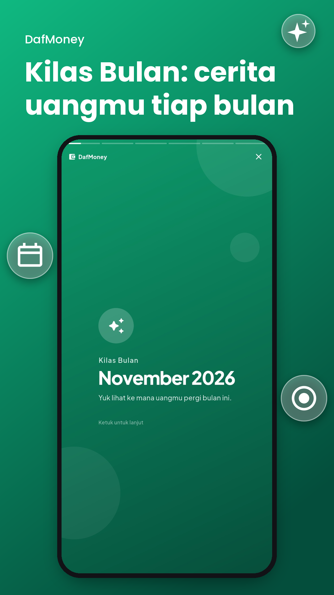
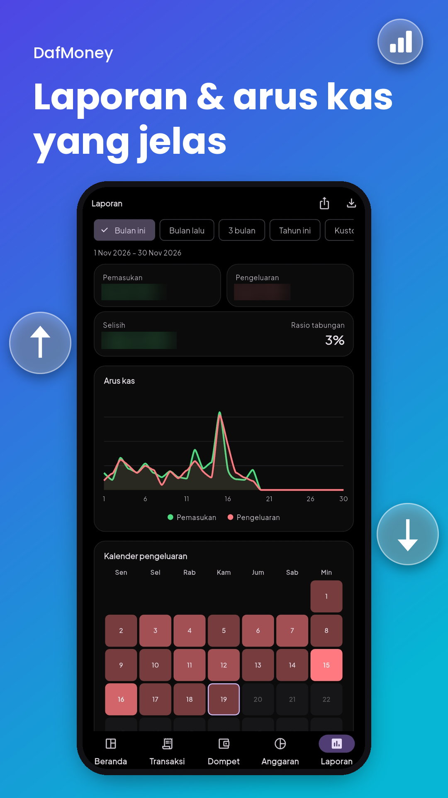

# 💰 DafMoney - Aplikasi Catatan Keuangan Pribadi

**DafMoney** adalah aplikasi pencatat keuangan pribadi modern berbasis Android & iOS yang dibangun menggunakan **Flutter**, **Riverpod**, dan **Firebase**. Aplikasi ini dirancang untuk membantu Anda mengelola arus kas (pemasukan dan pengeluaran), menetapkan anggaran bulanan, menganalisis statistik keuangan melalui grafik interaktif, serta menjaga keamanan data transaksi Anda.

---

## 📥 Unduh Aplikasi

1. Buka halaman [**Releases**](https://github.com/dapxzhosting/DafMoney/releases/latest).
2. Pada bagian **Assets**, ketuk **`daf_money.apk`** untuk mengunduh (±75 MB).
3. Buka file hasil unduhan, izinkan **instal dari sumber tidak dikenal** jika diminta, lalu ketuk **Install**.

> Butuh Android 6.0 (API 23) ke atas dan koneksi internet.

---

## 📸 Tampilan

<p align="center">
  
  
  
  
  
</p>

---

## 🌟 Fitur Utama

### 🔐 1. Otentikasi & Manajemen Akun
* **Pendaftaran & Login:** Registrasi akun baru berbasis Email & Password.
* **Verifikasi Email:** Email harus diverifikasi sebelum fitur utama bisa diakses.
* **Lupa Kata Sandi:** Reset password otomatis via link email.
* **Manajemen Profil:** Ubah nama profil, hingga hapus akun permanen.
* **Kunci Biometrik:** Amankan aplikasi dengan sidik jari/biometrik perangkat.
* **Onboarding:** Pengenalan singkat untuk pengguna baru.

### 📊 2. Beranda Interaktif
* **Kartu Saldo:** Total saldo, pemasukan, dan pengeluaran *realtime*, dengan grafik mini 7 hari dan tombol sembunyikan saldo.
* **Navigasi Bulan:** Pindah antar bulan langsung dari beranda.
* **Aksi Cepat:** Pintasan Pemasukan, Pengeluaran, Dompet, dan Laporan.
* **Transaksi Terbaru & Grafik Tren:** Riwayat terakhir serta grafik arus kas.

### 💸 3. Pencatatan Transaksi
* **Pencatatan Cepat:** Tambah, ubah, dan hapus transaksi Pemasukan atau Pengeluaran, dengan **Undo** setelah menghapus.
* **Format Rupiah:** Input dan tampilan otomatis terformat (`Rp`).
* **Saran Kategori:** Kategori disarankan otomatis dari catatan yang diketik.
* **Foto Struk:** Lampirkan foto struk pada transaksi.
* **Pencarian & Filter:** Saring transaksi berdasarkan bulan, kategori, dompet, dan lainnya.

### 👛 4. Dompet
* **Banyak Dompet:** Kelola tunai, rekening bank, dan dompet digital (mis. Dana) dengan ikon dan warna sendiri.
* **Saldo per Dompet:** Setiap dompet punya saldo awal dan saldo berjalan.

### 🎯 5. Anggaran (Budgeting)
* **Batas Bulanan:** Tetapkan batas anggaran per kategori per bulan.
* **Progres Penggunaan:** Indikator visual persentase anggaran yang terpakai.
* **Peringatan Anggaran:** Notifikasi saat pengeluaran mencapai 80% dan 100%.
* **Salin Anggaran:** Salin struktur anggaran dari bulan sebelumnya.

### 🏷️ 6. Kategori
* **Kategori Bawaan:** Terisi otomatis saat pengguna baru mendaftar.
* **Kategori Kustom:** Atur nama, jenis (Pemasukan/Pengeluaran), warna, dan ikon.

### ✨ 7. Wawasan & Kilas Bulan
* **Kartu Wawasan:** Insight otomatis dari kebiasaan keuanganmu.
* **Kilas Bulan:** Ringkasan bulanan bergaya *story* (seperti Spotify Wrapped), misalnya kategori tempat uangmu paling banyak mengalir.

### 🔥 8. Tantangan Tanpa Belanja
* Bertahan **tanpa pengeluaran di satu kategori** dengan target hari yang kamu tentukan.
* Hitung hari berjalan, rekor terbaik, dan **lencana pencapaian** (3, 7, 14, 30, 60, 100 hari).

### 📈 9. Laporan & Analisis
* **Rentang Fleksibel:** Bulan ini, bulan lalu, 3 bulan, tahun ini, atau kustom.
* **Grafik Arus Kas:** Perbandingan pemasukan dan pengeluaran per hari.
* **Kalender Pengeluaran:** Peta panas (*heatmap*) pengeluaran harian.
* **Rasio Tabungan:** Persentase tabungan terhadap total pemasukan.
* **Ekspor & Bagikan:** Simpan laporan sebagai **PDF** atau **gambar**, lalu bagikan.

### ⚙️ 10. Pengaturan & Kustomisasi
* **Saldo Awal**, **Kelola Dompet**, dan **Kelola Kategori**.
* **Pengingat Harian:** Notifikasi pada jam pilihan (dilewati bila hari ini sudah mencatat) dan tombol uji notifikasi.
* **Tema:** Terang, Gelap, atau Ikuti Sistem, plus **warna aksen**, *dynamic color*, dan mode **AMOLED**.
* **Widget Layar Utama & Quick Actions** (Android) untuk mencatat lebih cepat.
* **Manajemen Data:** Reset semua data transaksi atau hapus akun.

---

## 🛠️ Teknologi & Library

* **Framework:** [Flutter](https://flutter.dev) (Dart SDK >= 3.13.5)
* **State Management:** [Flutter Riverpod](https://riverpod.dev)
* **Navigasi & Routing:** [GoRouter](https://pub.dev/packages/go_router)
* **Backend & Database:** [Firebase Authentication](https://firebase.google.com/docs/auth) & [Cloud Firestore](https://firebase.google.com/docs/firestore)
* **Grafik & Visualisasi:** [FL Chart](https://pub.dev/packages/fl_chart)
* **Animasi & Desain:** [Flutter Animate](https://pub.dev/packages/flutter_animate), [Google Fonts](https://pub.dev/packages/google_fonts), Material Design 3
* **Penyimpanan Lokal:** `shared_preferences`
* **Fitur Android:** `flutter_local_notifications`, `home_widget`, `quick_actions`, `local_auth` (biometrik), `dynamic_color`
* **Ekspor & Berbagi:** `pdf`, `share_plus`, `path_provider`, `image_picker`

---

## 📁 Struktur Proyek

```text
lib/
├── app.dart                   # Root MaterialApp & konfigurasi tema/lokalisasi
├── firebase_options.dart      # Konfigurasi Firebase otomatis dari CLI
├── main.dart                  # Entry point aplikasi & inisialisasi layanan
├── core/                      # Modul bersama (constants, models, services, theme, router, widgets, utils)
│   ├── constants/             # Konstanta global aplikasi
│   ├── error/                 # Penanganan exception & error
│   ├── models/                # Model bersama (mis. jenis transaksi)
│   ├── providers/             # Riverpod providers global (Firebase, Session, Prefs)
│   ├── router/                # Konfigurasi GoRouter & proteksi rute
│   ├── services/              # Notifikasi, biometrik, widget, quick actions
│   ├── theme/                 # Skema warna & tema (Light & Dark)
│   ├── utils/                 # Formatter tanggal, angka, validator
│   └── widgets/               # Reusable UI widgets (Charts, Buttons, Dialogs)
└── features/                  # Modul fitur berbasis arsitektur Feature-First
    ├── auth/                  # Login, Register, Verify Email, Reset Password
    ├── budgets/               # Manajemen Anggaran Bulanan
    ├── categories/            # Pengelolaan Kategori Transaksi
    ├── challenge/             # Tantangan Tanpa Belanja & lencana
    ├── dashboard/             # Halaman Utama / Beranda
    ├── export/                # Ekspor laporan ke PDF / gambar
    ├── insights/              # Kartu Wawasan & Kilas Bulan
    ├── onboarding/            # Pengenalan untuk pengguna baru
    ├── reports/               # Laporan, Grafik & Kalender Pengeluaran
    ├── settings/              # Profil, Tema, Pengingat & Saldo Awal
    ├── splash/                # Splash Screen
    ├── transactions/          # Pencatatan Transaksi (+ foto struk)
    └── wallets/               # Manajemen Dompet
```

---

## 🚀 Panduan Setup & Instalasi

### 1. Prasyarat
Pastikan komputer Anda sudah terinstall:
* [Flutter SDK](https://docs.flutter.dev/get-started/install) (versi `>= 3.13.5`)
* [Android Studio](https://developer.android.com/studio) / VS Code
* Akun [Firebase](https://console.firebase.google.com/)

### 2. Clone Repositori
```bash
git clone https://github.com/dapxzhosting/DafMoney.git
cd DafMoney
```

### 3. Install Dependensi
```bash
flutter pub get
```

### 4. Konfigurasi Firebase
Aplikasi ini membutuhkan Firebase Authentication dan Cloud Firestore.

1. Buat project baru di [Firebase Console](https://console.firebase.google.com/).
2. Aktifkan **Authentication** dengan metode **Email/Password**.
3. Aktifkan **Cloud Firestore Database**.
4. Hubungkan project dengan Flutter menggunakan [FlutterFire CLI](https://firebase.google.com/docs/flutter/setup):
   ```bash
   npm install -g firebase-tools
   dart pub global activate flutterfire_cli
   flutterfire configure
   ```
5. Untuk Android, unduh file `google-services.json` dari Firebase Console dan letakkan di direktori:
   `android/app/google-services.json`

### 5. Jalankan Aplikasi
* **Mode Debug:**
  ```bash
  flutter run
  ```
* **Build APK Release:**
  ```bash
  flutter build apk
  ```

---

## 🔧 Troubleshooting & FAQ

### ❓ 1. Aplikasi Force Close / Crash saat dibuka pada Release APK
* **Penyebab:** Izin akses Internet belum terdaftar pada `AndroidManifest.xml` rilis.
* **Solusi:** Pastikan tag berikut ada di file `android/app/src/main/AndroidManifest.xml`:
  ```xml
  <uses-permission android:name="android.permission.INTERNET"/>
  ```

### ❓ 2. Pengingat / Notifikasi Tidak Muncul
* **Penyebab:** Izin notifikasi belum diberikan, atau penghemat baterai membatasi aplikasi.
* **Solusi:** Aktifkan izin **Notifikasi** untuk DafMoney di pengaturan Android, matikan pembatasan baterai untuk aplikasi ini, lalu coba **Kirim notifikasi uji** di menu Pengaturan.

### ❓ 3. Stuck di Halaman Splash / Logo
* **Penyebab:** Aplikasi tidak dapat terhubung ke Firebase atau file `google-services.json` belum sesuai.
* **Solusi:**
  1. Pastikan koneksi internet pada perangkat aktif.
  2. Periksa kembali konfigurasi `google-services.json` di folder `android/app/`.
  3. Cek log error asli dengan menghubungkan HP via USB dan jalankan:
     ```bash
     flutter run --release
     ```

### ❓ 4. Build Error `immutable workspace` pada Gradle
* **Penyebab:** Cache transform Gradle corrupt atau terganggu oleh antivirus saat build.
* **Solusi:** Bersihkan cache Flutter dan Gradle dengan perintah:
  ```bash
  cd android
  gradlew --stop
  cd ..
  flutter clean
  flutter pub get
  ```
  Hapus juga folder `.gradle/caches` jika diperlukan, lalu coba build ulang.

### ❓ 5. Email Verifikasi Tidak Diterima
* **Penyebab:** Email masuk ke folder *Spam* atau limit pengiriman email Firebase terlampaui.
* **Solusi:** Periksa folder *Spam/Junk* pada email Anda atau gunakan tombol **Kirim Ulang Email** pada halaman verifikasi.

---

## 📜 Aturan Keamanan Firestore (Security Rules)

Aturan lengkap ada di file [`firestore.rules`](firestore.rules). Aturan ini memastikan:

* Pengguna **hanya bisa mengakses data miliknya sendiri** (`users/{uid}`).
* Data transaksi, dompet, kategori, anggaran, dan struk hanya bisa diakses setelah **email terverifikasi**.
* Setiap dokumen **divalidasi** (tipe data, panjang teks, batas nominal, dan ukuran foto struk maksimal ±900 KB).
* Semua akses lain **ditolak**.

Terapkan ke project Firebase kamu dengan:

```bash
firebase deploy --only firestore:rules
```

---

## 📄 Lisensi

Proyek ini dibuat untuk keperluan *Open Source*. Bebas digunakan, dimodifikasi, dan dikembangkan kembali.
