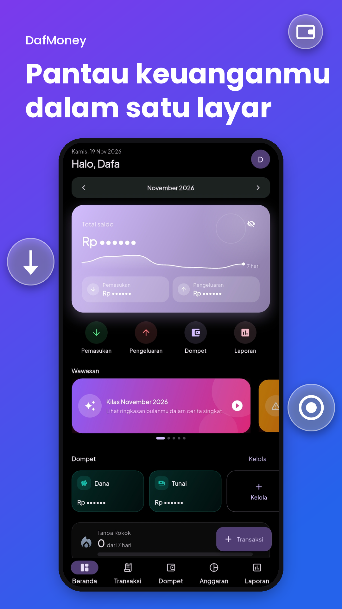
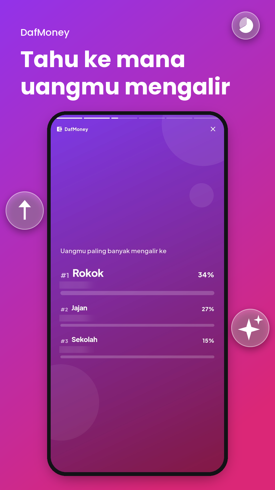
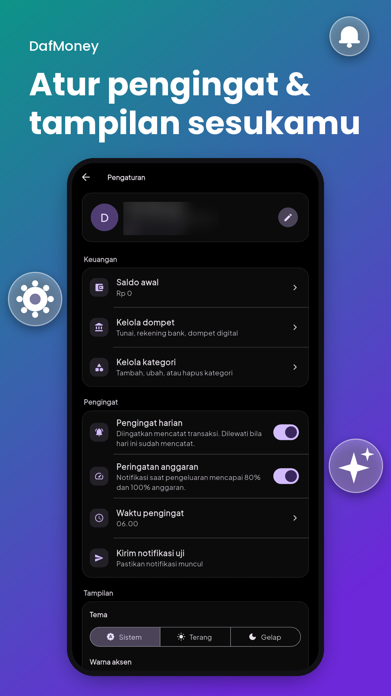

<div align="center">

# 💰 DafMoney

**Aplikasi pencatatan keuangan pribadi berbasis Flutter dan Firebase.**

Catat pemasukan dan pengeluaran, kelola dompet, pantau anggaran, serta pahami pola keuangan melalui laporan dan wawasan otomatis.


[Unduh APK](https://github.com/dapxzhosting/DafMoney/releases) · [Laporkan Bug](https://github.com/dapxzhosting/DafMoney/issues) · [Lihat Source Code](https://github.com/dapxzhosting/DafMoney)

</div>

---

## 📸 Tampilan Aplikasi

<p align="center">
  
  
  
  
  
</p>

<p align="center">
  <sub>Beranda · Kilas Bulan · Kategori Teratas · Laporan · Pengaturan</sub>
</p>

---

## 📖 Daftar Isi

- [Tentang DafMoney](#-tentang-dafmoney)
- [Fitur Utama](#-fitur-utama)
- [Catat Cepat di Android](#-catat-cepat-di-android)
- [Teknologi](#️-teknologi)
- [Struktur Proyek](#-struktur-proyek)
- [Struktur Data Firestore](#️-struktur-data-firestore)
- [Persiapan dan Instalasi](#-persiapan-dan-instalasi)
- [Keamanan](#-keamanan)
- [Build APK](#-build-apk)
- [Pengujian](#-pengujian)
- [GitHub Actions](#-github-actions)
- [Troubleshooting](#-troubleshooting)
- [Kredit](#-kredit)
- [Lisensi](#-lisensi)
- [Kontribusi dan Laporan Bug](#-kontribusi-dan-laporan-bug)

---

## 💡 Tentang DafMoney

DafMoney adalah aplikasi pencatatan keuangan pribadi yang membantu pengguna mencatat transaksi dan mengelola keuangan dalam satu tempat. Aplikasi ini dibuat menggunakan Flutter, dengan Firebase Authentication untuk autentikasi dan Cloud Firestore untuk penyimpanan serta sinkronisasi data.

DafMoney ditujukan untuk penggunaan pribadi. Aplikasi ini bukan layanan perbankan, bukan penasihat keuangan, dan tidak terhubung secara otomatis ke rekening bank.

## 🌟 Fitur Utama

### 🔐 Akun dan Keamanan

- Daftar dan masuk menggunakan email serta kata sandi, atau akun Google, melalui Firebase Authentication.
- Verifikasi email sebelum pengguna dapat mengakses data yang dilindungi.
- Reset kata sandi melalui email.
- Pengelolaan profil, termasuk mengubah nama dan kata sandi.
- Kunci aplikasi dengan sidik jari, wajah, atau PIN/pola perangkat.
- **PIN aplikasi** 4-6 digit buatan DafMoney sendiri dengan keypad di layar kunci. Jika PIN diatur, aplikasi hanya dapat dibuka dengan sidik jari atau PIN DafMoney (PIN/pola perangkat tidak lagi berlaku). Lima kali salah, keypad terkunci 30 detik. PIN disimpan hanya di perangkat (hash + salt per akun), tidak dikirim ke Firestore, dan tidak dapat dipulihkan: jika lupa, keluar dari akun lalu masuk lagi.
- Penghapusan akun beserta data pengguna melalui aplikasi. Prosesnya meminta autentikasi ulang (kata sandi, atau memilih akun Google yang sama), ketikan `HAPUS` sebagai konfirmasi, dan menyediakan tombol **Simpan backup dulu**.
- Onboarding untuk pengguna baru dan splash screen.

### 🏠 Beranda

- Ringkasan saldo, pemasukan, dan pengeluaran pada periode terpilih.
- Grafik mini aktivitas keuangan selama 7 hari.
- Fitur sembunyikan saldo yang disimpan secara lokal di perangkat.
- Pemilih bulan untuk melihat periode lain.
- Akses cepat ke pemasukan, pengeluaran, dompet, dan laporan.
- Ringkasan dompet dan wawasan keuangan.
- Kartu tantangan tanpa jajan.

### 💸 Transaksi

- Tambah, ubah, dan hapus transaksi pemasukan maupun pengeluaran.
- Fitur undo setelah transaksi dihapus.
- Format nominal Rupiah saat memasukkan nominal.
- Pemilihan kategori dan dompet untuk transaksi.
- Lampiran foto struk dari kamera atau galeri.
- Saran kategori berdasarkan catatan transaksi yang diproses di perangkat.
- Pencarian dan filter berdasarkan kata kunci, jenis transaksi, kategori, dompet, nominal, dan periode.

### 👛 Dompet

- Mengelola beberapa dompet, seperti uang tunai, rekening bank, dan dompet digital.
- Mengatur nama, ikon, warna, dan saldo awal setiap dompet.
- Saldo dompet dihitung dari saldo awal dan transaksi yang tercatat.

### 🎯 Anggaran

- Mengatur batas pengeluaran per kategori untuk setiap bulan.
- Melihat persentase penggunaan anggaran.
- Peringatan ketika penggunaan anggaran mencapai 80% dan 100%.
- Menyalin anggaran dari bulan sebelumnya.

### 🔁 Transaksi Berulang

- Membuat jadwal transaksi harian, mingguan, bulanan, atau tahunan.
- Cocok untuk mencatat pemasukan rutin, langganan, dan cicilan.
- Transaksi berulang diproses saat aplikasi dibuka.
- Penyesuaian tanggal untuk bulan yang lebih pendek.

### 🔄 Transfer Antar Dompet

- Memindahkan saldo dari satu dompet ke dompet lain.
- Transfer tidak dihitung sebagai pemasukan atau pengeluaran pada laporan.

### 🏁 Target Tabungan

- Membuat target nominal tabungan.
- Memantau progres dan tenggat target.
- Melihat saran jumlah tabungan sesuai sisa waktu: per bulan (tenggat 30 hari atau lebih), per minggu (7-29 hari), atau per hari (kurang dari seminggu).
- Target tabungan berfungsi sebagai pelacak progres dan tidak otomatis mengubah saldo dompet.

### 🤝 Utang dan Piutang

- Mencatat utang maupun piutang.
- Mencatat pembayaran secara bertahap.
- Memantau sisa pembayaran, progres, dan status jatuh tempo.
- Pengingat untuk catatan yang mendekati atau melewati jatuh tempo.

### 📥 Impor, Ekspor, dan Backup

- Mengekspor data transaksi ke CSV.
- Mengimpor transaksi dengan pratinjau sebelum disimpan.
- Deteksi data duplikat.
- Pembuatan kategori atau dompet yang diperlukan saat proses impor.
- Mendukung pemisah koma dan titik koma serta format nominal/tanggal Indonesia.
- Backup lengkap ke satu berkas JSON (transaksi, kategori, dompet, anggaran, transaksi berulang, transfer, target tabungan, dan utang; foto struk tidak ikut) dengan pratinjau sebelum dipulihkan. Data yang sudah ada dilewati, bukan ditimpa.

### 🏷️ Kategori

- Kategori bawaan untuk pengguna baru.
- Kategori kustom dengan nama, jenis transaksi, warna, dan ikon.

### 📈 Laporan dan Analisis

- Rentang laporan bulanan, bulan sebelumnya, 3 bulan, tahun ini, atau rentang kustom.
- Ringkasan pemasukan, pengeluaran, selisih, dan rasio tabungan.
- Grafik arus kas harian.
- Kalender pengeluaran berbentuk heatmap.
- Diagram distribusi pengeluaran per kategori.
- Perbandingan pengeluaran antarbulan.

### 🧾 Ekspor Laporan

- Ekspor laporan ke PDF.
- Ekspor ringkasan laporan sebagai gambar.
- Pilihan untuk menyertakan atau menyembunyikan daftar transaksi pada laporan PDF.
- Cakupan laporan bulanan, tahunan, seluruh riwayat, atau rentang tanggal kustom.

### ✨ Wawasan Otomatis dan Kilas Bulan

- Wawasan berdasarkan riwayat transaksi, seperti kategori pengeluaran terbesar, perubahan pengeluaran, kondisi anggaran, dan tingkat tabungan.
- Kilas Bulan berupa ringkasan keuangan bulanan bergaya stories yang dapat dibagikan.

### 🔥 Tantangan Tanpa Jajan

- Memilih kategori dan target hari.
- Memantau streak berjalan dan rekor terbaik.
- Lencana pencapaian berdasarkan durasi tantangan.

### 🔔 Pengingat

- Pengingat harian untuk mencatat transaksi.
- Notifikasi peringatan anggaran.
- Notifikasi pengingat jatuh tempo.
- Fitur kirim notifikasi uji.

### ☁️ Sinkronisasi dan Mode Offline

- Data tetap bisa dicatat saat offline dan disinkronkan otomatis ketika koneksi kembali.
- Banner **Menunggu sinkron** tampil di beranda selama masih ada transaksi yang belum terkirim ke server.
- Jika server menolak perubahan setelah layar sempat menampilkannya sebagai berhasil (misalnya karena aturan keamanan), aplikasi menampilkan peringatan dan mengirim laporan non-fatal ke Firebase Crashlytics.
- Menghapus semua transaksi saat offline memberi tahu bahwa penghapusan tersimpan di perangkat dan akan disinkronkan nanti.

### 🎨 Personalisasi

- Tema sistem, terang, dan gelap.
- Mode AMOLED.
- Pilihan warna aksen dan warna dinamis Material You pada perangkat yang mendukung.
- Pengaturan saldo awal.
- Beberapa preferensi pengguna disinkronkan melalui akun.

## ⚡ Catat Cepat di Android

DafMoney menyediakan beberapa cara untuk mencatat transaksi tanpa harus membuka aplikasi secara penuh:

| Fitur | Keterangan |
|---|---|
| Notifikasi Catat Cepat | Tombol pemasukan dan pengeluaran serta kolom untuk memasukkan transaksi. |
| Widget layar utama | Menampilkan ringkasan saldo dan sisa anggaran serta menyediakan pintasan pencatatan. |
| Quick Settings Tile | Pintasan Catat transaksi dari panel Quick Settings Android. |
| Menu Bagikan | Mengirim teks dari aplikasi lain ke DafMoney untuk diproses sebagai transaksi. |
| App Shortcuts | Pintasan pemasukan dan pengeluaran dari ikon aplikasi. |
| Input suara | Memasukkan transaksi menggunakan suara pada layar Catat Cepat. |

### Contoh format Catat Cepat

| Teks yang dimasukkan | Nominal yang dibaca | Catatan |
|---|---:|---|
| `makan siang 25rb` | Rp25.000 | Makan siang |
| `gaji 5jt` | Rp5.000.000 | Gaji |
| `bensin 1,5jt` | Rp1.500.000 | Bensin |
| `kopi 15.000` | Rp15.000 | Kopi |
| `parkir 3k` | Rp3.000 | Parkir |
| `beli 2 galon 30000` | Rp30.000 | Beli 2 galon |
| `Rp 12.500 bakso` | Rp12.500 | Bakso |

Parser mengenali akhiran `rb`, `ribu`, `k`, `jt`, dan `juta`. Angka polos di bawah 1.000 dapat dianggap sebagai jumlah barang, bukan nominal Rupiah.

---

## 🛠️ Teknologi

| Kebutuhan | Teknologi |
|---|---|
| Framework | [Flutter](https://flutter.dev/) dan Material Design 3 |
| Bahasa | [Dart](https://dart.dev/) |
| State management | [flutter_riverpod](https://riverpod.dev/) |
| Navigasi | [go_router](https://pub.dev/packages/go_router) |
| Autentikasi dan database | [Firebase Authentication](https://firebase.google.com/docs/auth) (email/kata sandi dan Google), [Cloud Firestore](https://firebase.google.com/docs/firestore), [google_sign_in](https://pub.dev/packages/google_sign_in) |
| Pemantauan | [Firebase Crashlytics](https://firebase.google.com/docs/crashlytics) dan [Firebase App Check](https://firebase.google.com/docs/app-check) |
| Grafik | [fl_chart](https://pub.dev/packages/fl_chart) |
| Animasi dan font | [flutter_animate](https://pub.dev/packages/flutter_animate), [google_fonts](https://pub.dev/packages/google_fonts) |
| Warna dinamis | [dynamic_color](https://pub.dev/packages/dynamic_color) |
| Notifikasi | [flutter_local_notifications](https://pub.dev/packages/flutter_local_notifications), [timezone](https://pub.dev/packages/timezone) |
| Widget dan pintasan | [home_widget](https://pub.dev/packages/home_widget), [quick_actions](https://pub.dev/packages/quick_actions) |
| Ekspor dan berbagi | [pdf](https://pub.dev/packages/pdf), [share_plus](https://pub.dev/packages/share_plus), [path_provider](https://pub.dev/packages/path_provider) |
| Media dan suara | [image_picker](https://pub.dev/packages/image_picker), [speech_to_text](https://pub.dev/packages/speech_to_text) |
| Penyimpanan lokal | [shared_preferences](https://pub.dev/packages/shared_preferences) |
| Keamanan lokal | [local_auth](https://pub.dev/packages/local_auth) (sidik jari/wajah), [crypto](https://pub.dev/packages/crypto) (hash PIN aplikasi) |
| Lainnya | `intl`, `equatable`, `file_picker`, `audioplayers` |

---

## 📁 Struktur Proyek

DafMoney menggunakan pendekatan **feature-first**. Kode fitur dikelompokkan berdasarkan kebutuhan aplikasi, sedangkan komponen yang digunakan bersama ditempatkan di `core/`.

```text
lib/
├── main.dart
├── app.dart
├── firebase_options.dart
├── quick_add/
├── core/
│   ├── constants/
│   ├── error/
│   ├── models/
│   ├── providers/
│   ├── router/
│   ├── services/
│   ├── theme/
│   ├── utils/
│   └── widgets/
└── features/
    ├── auth/
    ├── onboarding/
    ├── splash/
    ├── dashboard/
    ├── transactions/
    ├── wallets/
    ├── budgets/
    ├── categories/
    ├── reports/
    ├── export/
    ├── insights/
    ├── challenge/
    ├── goals/
    ├── debts/
    ├── recurring/
    ├── transfers/
    ├── data_io/
    └── settings/

android/app/src/main/kotlin/com/example/keuangan/
├── MainActivity.kt
├── DafMoneyWidgetProvider.kt
├── QuickAddActivity.kt
└── QuickAddTileService.kt

docs/
└── screenshots/

firestore.rules
.github/
└── workflows/
```

---

## 🗄️ Struktur Data Firestore

Data aplikasi disimpan di bawah dokumen pengguna (`users/{uid}`) dan dipisahkan ke dalam subkoleksi.

```text
users/{uid}
├── categories/{id}
├── transactions/{id}
├── wallets/{id}
├── receipts/{transactionId}
├── budgets/{yyyy-MM_categoryId}
├── recurring/{id}
├── transfers/{id}
├── goals/{id}
└── debts/{id}
```

Nominal uang disimpan sebagai bilangan bulat Rupiah (`int`) agar tidak menggunakan pecahan desimal untuk perhitungan uang.

> Struktur di atas merupakan gambaran koleksi utama. Field setiap dokumen mengikuti implementasi model dan aturan pada `firestore.rules`.

---

## 🚀 Persiapan dan Instalasi

### Persyaratan

- Flutter SDK stable dengan Dart SDK yang memenuhi batas versi pada `pubspec.yaml` (saat dokumentasi ini disusun, proyek mencantumkan Dart `^3.13.5`).
- Android Studio atau Visual Studio Code.
- Android SDK.
- JDK 17.
- Akun dan project [Firebase](https://console.firebase.google.com/).
- Node.js untuk memasang Firebase CLI.

### 1. Clone repository

```bash
git clone https://github.com/dapxzhosting/DafMoney.git
cd DafMoney
```

### 2. Pasang dependensi Flutter

```bash
flutter pub get
```

### 3. Siapkan Firebase

1. Buat project di [Firebase Console](https://console.firebase.google.com/).
2. Aktifkan **Authentication** dengan metode **Email/Password** dan **Google**. Untuk Google Sign-In di Android, daftarkan sidik jari SHA-1 dan SHA-256 aplikasi di pengaturan project Firebase, lalu unduh ulang `google-services.json`.
3. Buat atau aktifkan **Cloud Firestore**.
4. Pasang Firebase CLI dan FlutterFire CLI.

```bash
npm install -g firebase-tools
firebase login
dart pub global activate flutterfire_cli
```

5. Hubungkan aplikasi dengan project Firebase milikmu:

```bash
flutterfire configure
```

Ikuti instruksi CLI untuk memilih project dan platform. Perintah tersebut akan menyiapkan konfigurasi Firebase untuk aplikasi.

6. Pastikan konfigurasi Android yang diperlukan tersedia, termasuk `google-services.json` jika digunakan oleh konfigurasi Gradle project.
7. Deploy aturan Firestore dari repository:

```bash
firebase deploy --only firestore:rules
```

**Penting:** jangan menjalankan aplikasi yang terhubung ke database produksi sebelum memastikan Firestore Rules yang sesuai sudah diterapkan.

### 4. Jalankan aplikasi

```bash
flutter run
```

---

## 🔒 Keamanan

Aturan akses database berada di file [`firestore.rules`](firestore.rules). Baca dan sesuaikan file tersebut sebelum menghubungkan aplikasi ke project Firebase yang akan digunakan.

Hal yang perlu diperhatikan:

- Setiap pengguna hanya boleh mengakses data miliknya sendiri.
- Akses data yang dilindungi mensyaratkan email Firebase Authentication telah diverifikasi.
- Aturan Firestore melakukan validasi terhadap field dan tipe data yang diizinkan.
- Terapkan Firestore Rules ke project Firebase yang benar sebelum aplikasi digunakan. Aturan yang ter-deploy harus sama dengan `firestore.rules` di repository; aturan lama akan menolak field pengaturan yang baru dan menimbulkan error `permission-denied`.
- PIN aplikasi hanya melindungi akses ke aplikasi di perangkat. PIN disimpan sebagai hash di penyimpanan lokal biasa (`shared_preferences`), bukan penyimpanan terenkripsi, sehingga tidak menggantikan enkripsi perangkat.
- Pertimbangkan mengaktifkan Firebase App Check dengan Play Integrity untuk aplikasi Android yang didistribusikan secara publik.
- Batasi API key melalui pengaturan Google Cloud sesuai kebutuhan platform.
- Jangan pernah memasukkan service account private key atau kredensial server ke dalam aplikasi Flutter atau repository publik.

File `google-services.json` dan `firebase_options.dart` berisi konfigurasi identitas aplikasi Firebase. Keduanya bukan pengganti aturan keamanan database. **Keamanan data tetap bergantung pada konfigurasi Firebase Authentication, Firestore Rules, dan pengaturan project Firebase.**

---

## 📦 Build APK

Untuk membuat APK release secara lokal:

```bash
flutter clean
flutter pub get
flutter analyze
flutter test
flutter build apk --release
```

Hasil APK biasanya tersedia di:

```text
build/app/outputs/flutter-apk/app-release.apk
```

Untuk distribusi publik, siapkan konfigurasi signing release milik sendiri. Jangan membagikan APK yang ditandatangani dengan debug key sebagai rilis produksi. Simpan keystore dan password di tempat aman; jangan commit ke repository.

---

## 🧪 Pengujian

Jalankan seluruh unit test dengan:

```bash
flutter test
```

Jalankan pemeriksaan statis dengan:

```bash
flutter analyze
```

Test yang tercantum di repository mencakup beberapa area berikut:

| File test | Cakupan |
|---|---|
| `quick_entry_parser_test.dart` | Parsing teks Catat Cepat dan format nominal |
| `recurring_test.dart` | Perhitungan jadwal transaksi berulang, termasuk tanggal akhir bulan |
| `csv_test.dart` | Pemrosesan impor dan ekspor CSV |
| `goals_debts_transfers_test.dart` | Logika target tabungan, utang-piutang, dan transfer |
| `challenge_json_test.dart` | Bentuk data tantangan yang digunakan bersama Firestore Rules |
| `civil_date_test.dart` | Penanganan tanggal sipil (tanpa pergeseran zona waktu) |
| `period_summary_test.dart` | Ringkasan pemasukan dan pengeluaran per periode |
| `period_comparison_test.dart` | Perbandingan antarperiode |
| `widget_test.dart` | Pengujian widget dasar |

Belum ada test otomatis untuk PIN aplikasi (`AppPinService`) maupun saran tabungan sesuai sisa waktu (`savingPace`); keduanya perlu diuji manual. Test yang tersedia bukan jaminan bahwa seluruh alur aplikasi telah diuji. Sebelum rilis, lakukan juga pengujian manual pada login (email dan Google), kunci aplikasi dan PIN, hapus akun, sinkronisasi, transaksi, transfer, impor data, notifikasi, dan pemulihan ketika jaringan terputus.

---

## ⚙️ GitHub Actions

Repository menyediakan workflow GitHub Actions di folder `.github/workflows/` untuk pemeriksaan Flutter dan proses build APK.

- **Flutter CI**: menjalankan pengambilan dependensi, analisis kode, dan test pada pemicu yang ditentukan di file workflow.
- **Build DafMoney APK**: menjalankan proses build APK dan mengunggah hasilnya sebagai artifact jika workflow berhasil.

Untuk melihat hasilnya, buka tab **Actions** pada repository, pilih workflow dan run yang diinginkan, lalu periksa bagian **Artifacts**.

> Detail branch, trigger, nama artifact, serta kebutuhan GitHub Secrets mengikuti konfigurasi workflow terbaru di repository. Pastikan signing secret sudah tersedia untuk build release yang akan didistribusikan.

---

## 🔧 Troubleshooting

<details>
<summary><b>Aplikasi berhenti saat dibuka</b></summary>

- Pastikan perangkat menggunakan versi Android yang didukung.
- Pastikan izin Internet tersedia.
- Periksa konfigurasi Firebase Android dan file konfigurasi project.
- Untuk melihat log, jalankan aplikasi dari perangkat yang terhubung ke komputer.

```bash
flutter run --release
```

</details>

<details>
<summary><b>Aplikasi berhenti di splash screen</b></summary>

- Periksa koneksi internet.
- Pastikan konfigurasi Firebase sesuai dengan project yang digunakan.
- Pastikan Firebase Authentication dan Cloud Firestore sudah diaktifkan.
- Periksa log aplikasi untuk mengetahui error yang sebenarnya.

</details>

<details>
<summary><b>Data tidak muncul atau muncul permission-denied</b></summary>

- Pastikan pengguna sudah masuk dan email telah diverifikasi.
- Pastikan Firestore Rules sudah di-deploy ke project Firebase yang benar.
- Periksa apakah UID pengguna sesuai dengan lokasi dokumen yang diakses aplikasi.

```bash
firebase deploy --only firestore:rules
```

</details>

<details>
<summary><b>Muncul pesan "Perubahan terakhir gagal disimpan ke server"</b></summary>

- Berarti server menolak penulisan setelah layar sempat menampilkannya sebagai berhasil.
- Pastikan Firestore Rules yang ter-deploy sama dengan `firestore.rules` terbaru (`firebase deploy --only firestore:rules`).
- Pastikan email akun sudah terverifikasi.
- Buka Firebase Crashlytics, cari issue non-fatal `permission-denied`; stack trace-nya memuat nama metode DafMoney yang memicu penolakan.

</details>

<details>
<summary><b>Hapus akun gagal dengan pesan akun Google berbeda (user-mismatch)</b></summary>

Pilih akun Google yang sama dengan akun yang sedang masuk di DafMoney. Pesan error menampilkan alamat email yang harus dipilih.

</details>

<details>
<summary><b>Lupa PIN aplikasi</b></summary>

PIN tidak dapat dipulihkan. Ketuk **Keluar dari akun** di layar kunci, lalu masuk kembali. PIN lama dapat dihapus atau diganti dari Pengaturan setelah masuk.

</details>

<details>
<summary><b>Email verifikasi tidak diterima</b></summary>

- Periksa folder Spam atau Junk.
- Gunakan fitur kirim ulang email di aplikasi.
- Periksa template dan konfigurasi email pada Firebase Authentication.

</details>

<details>
<summary><b>Notifikasi tidak muncul</b></summary>

- Pastikan izin notifikasi untuk DafMoney telah diberikan.
- Pada Android 13 atau lebih baru, periksa izin `POST_NOTIFICATIONS`.
- Periksa pengaturan baterai perangkat karena beberapa produsen membatasi aktivitas aplikasi di latar belakang.
- Gunakan fitur notifikasi uji di aplikasi.

</details>

<details>
<summary><b>Widget tidak memperbarui data</b></summary>

Buka aplikasi utama untuk memperbarui data widget. Pastikan aplikasi tidak dibatasi oleh pengaturan baterai atau aktivitas latar belakang perangkat.

</details>

<details>
<summary><b>Build Gradle bermasalah</b></summary>

Coba hentikan proses Gradle, bersihkan hasil build Flutter, lalu pasang dependensi kembali.

```bash
cd android
./gradlew --stop
cd ..
flutter clean
flutter pub get
```

</details>

---

## 🖼️ Kredit

Beberapa ilustrasi pada folder `assets/illustrations/` berasal dari Freepik, termasuk karya Sabiqul Fahmi. Periksa dan penuhi ketentuan lisensi serta atribusi sumber ilustrasi sebelum mendistribusikan aplikasi.

---

## 📄 Lisensi

Pastikan repository memiliki file `LICENSE` yang menyatakan lisensi proyek secara eksplisit sebelum mengizinkan penggunaan, modifikasi, atau distribusi ulang oleh pihak lain. Sampai file lisensi ditambahkan dan dipilih oleh pemilik repository, ketentuan penggunaan ulang kode belum dinyatakan secara eksplisit di README ini.

---

## 🤝 Kontribusi dan Laporan Bug

Ide, masukan, dan laporan bug sangat dihargai.

1. Periksa apakah masalah yang sama sudah dilaporkan di [GitHub Issues](https://github.com/dapxzhosting/DafMoney/issues).
2. Buat issue baru dengan langkah untuk mereproduksi masalah, hasil yang diharapkan, hasil yang terjadi, dan screenshot atau log jika tersedia.
3. Untuk perubahan kode, buat branch terpisah dan ajukan Pull Request.
4. Jalankan `flutter analyze` dan `flutter test` sebelum mengirim perubahan.

---

<div align="center">

**Dibuat dengan 💚 menggunakan Flutter**

[ dapxzhosting ](https://github.com/dapxzhosting) · [ Repository DafMoney ](https://github.com/dapxzhosting/DafMoney)

</div>
